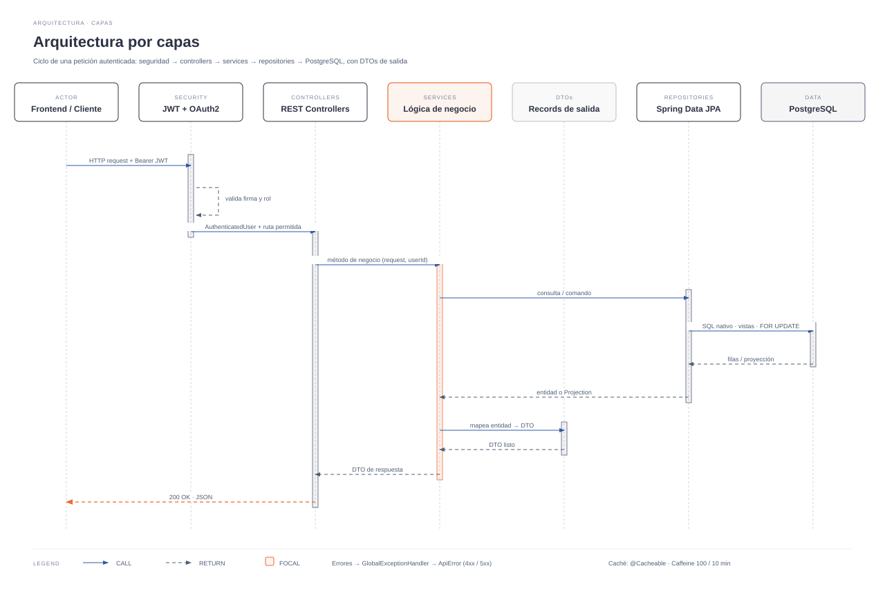
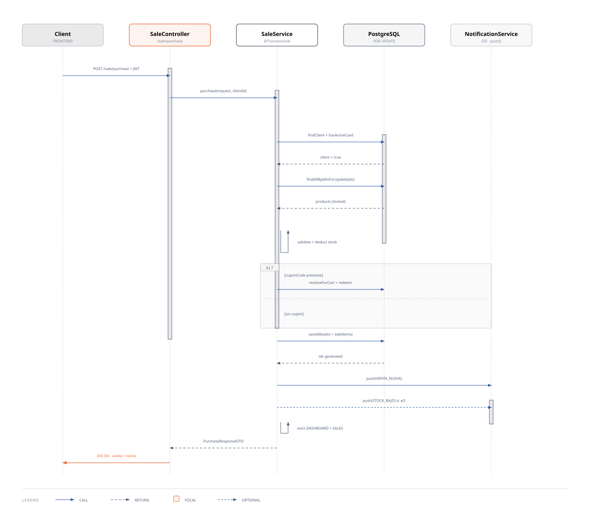
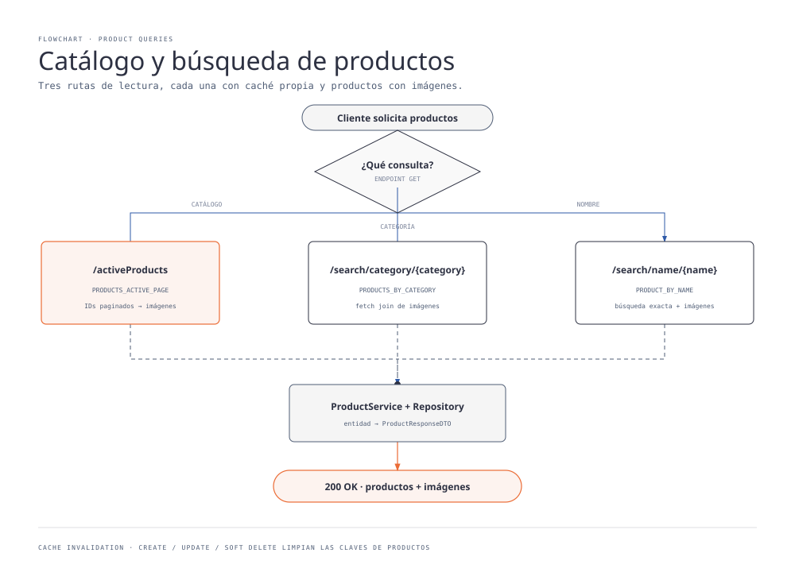
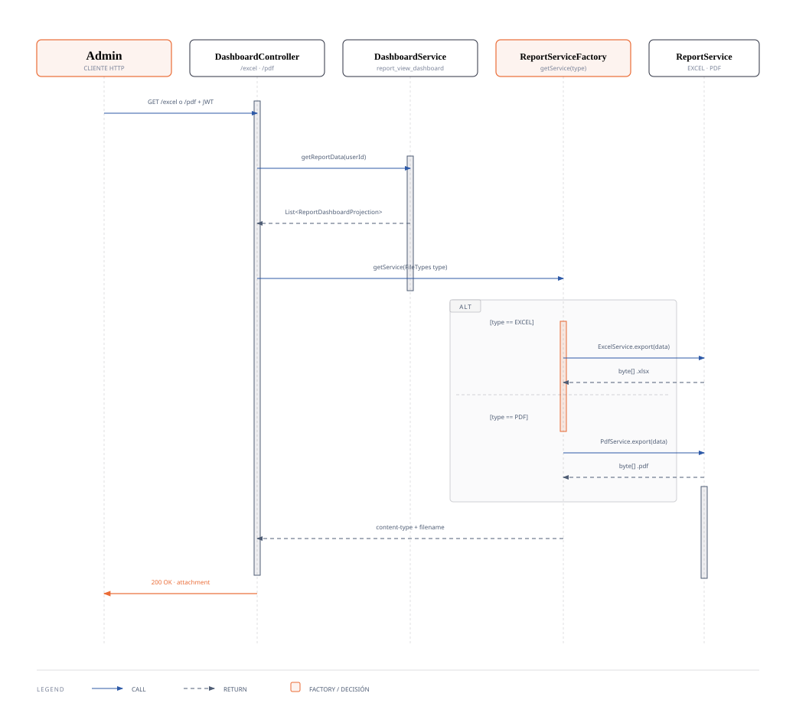
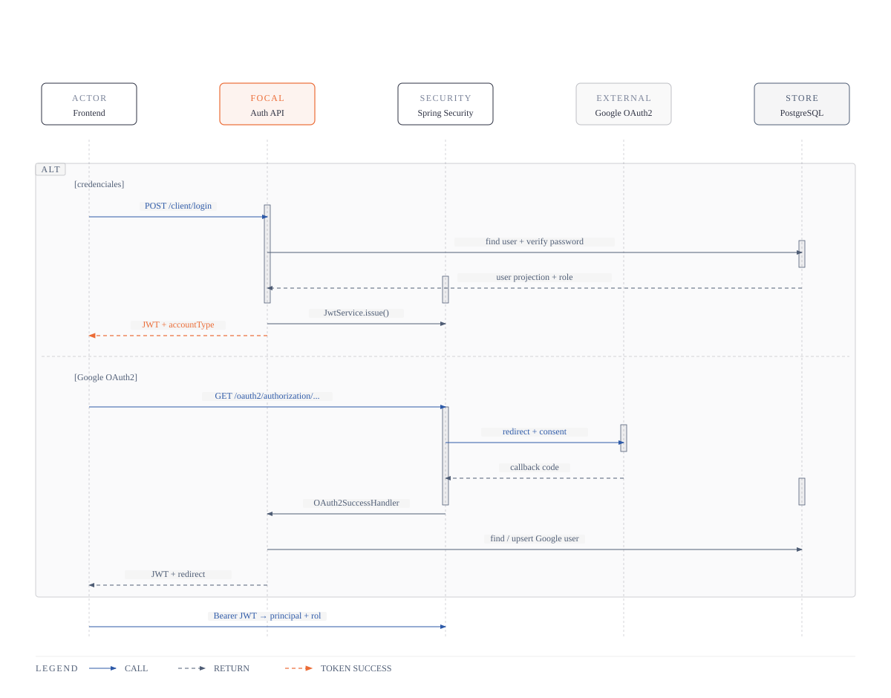

# ApiJuegoInventario

API REST para gestionar el inventario, catálogo y ventas de una tienda. El proyecto permite administrar productos, recibir compras de clientes, consultar métricas y generar reportes en Excel o PDF.

Construido con Java 25, Spring Boot 4.1.0 y PostgreSQL 16.

## Funcionalidades

- Autenticación con JWT y OAuth2 mediante Google.
- Roles separados para `ADMIN` y `CLIENT`.
- Registro, login y gestión de perfiles.
- Catálogo de productos con categorías, stock, estado e imágenes.
- Carga de imágenes en Cloudinary.
- Gestión de tarjetas simuladas para clientes.
- Flujo de compra con detalle de productos y totales.
- Historial de compras y ventas.
- Dashboard con ventas, productos, clientes y datos mensuales.
- Notificaciones en tiempo real mediante Server-Sent Events.
- Reportes descargables en Excel y PDF.
- Documentación OpenAPI / Swagger.

## Arquitectura

El proyecto sigue una arquitectura por capas. Cada petición entra por seguridad, pasa por controller → service → repository y vuelve como DTO:



Diagrama interactivo: [secuencia-arquitectura-capas.html](diagrams/secuencia-arquitectura-capas.html) · Fuente editable: [secuencia-arquitectura-capas.puml](diagrams/secuencia-arquitectura-capas.puml)

### Patrón Factory para reportes

Los endpoints de reportes no dependen directamente de una implementación concreta. `ReportServiceFactory` selecciona la estrategia adecuada según `FileTypes`:

```text
DashboardController
        |
        v
ReportServiceFactory.getService(type)
        |
        +--> ExcelService --> reporte_usuarios.xlsx
        |
        +--> PdfService   --> reporte_usuarios.pdf
```

Diagrama completo: [secuencia-reportes-factory.html](diagrams/secuencia-reportes-factory.html)

## Stack tecnológico

| Área | Tecnología |
|---|---|
| Lenguaje | Java 25 |
| Framework | Spring Boot 4.1.0 |
| API | Spring Web MVC |
| Persistencia | Spring Data JPA / Hibernate |
| Base de datos | PostgreSQL 16 |
| Seguridad | Spring Security, JWT y OAuth2 Google |
| Imágenes | Cloudinary |
| Excel | Apache POI |
| PDF | OpenPDF |
| Documentación | Springdoc OpenAPI / Swagger UI |
| Contenedores | Docker y Docker Compose |
| Build | Maven Wrapper |

## Requisitos

- Java 25
- Docker Desktop, recomendado para ejecutar la base de datos y la API
- Maven 3.8 o superior si no se usa el wrapper
- Credenciales de Cloudinary y Google OAuth2 para activar esas integraciones

## Configuración

Crea un archivo `.env` en la raíz del proyecto. 
(Para el que este siguiento las instrucciones) No subas este archivo al repositorio.

```env
DB_USERNAME=postgres
DB_PASSWORD=tu_password
DB_URL=jdbc:postgresql://localhost:5433/apiproject

JWT_SECRET_KEY=una_clave_secreta_segura
JWT_EXPIRATION_MS=86400000

BASIC_AUTH_USERNAME=admin
BASIC_AUTH_PASSWORD=tu_password_basico

CLOUDINARY_CLOUD_NAME=tu_cloud_name
CLOUDINARY_API_KEY=tu_api_key
CLOUDINARY_API_SECRET=tu_api_secret

GOOGLE_CLIENT_ID=tu_google_client_id
GOOGLE_CLIENT_SECRET=tu_google_client_secret
```

Para ejecución dentro de Docker Compose, la aplicación utiliza internamente `jdbc:postgresql://db:5432/apiproject`; el puerto `5433` es el puerto publicado para conexiones desde el equipo local.

## Ejecución con Docker

Levantar la base de datos y la API:

```bash
docker compose up --build
```

La API quedará disponible en (el compose publica el contenedor en el puerto **8081** del host,
solo en `127.0.0.1`; se cambia con `API_HOST_PORT`):

- API: http://localhost:8081
- Swagger UI: http://localhost:8081/swagger-ui.html
- Health check: http://localhost:8081/actuator/health
- PostgreSQL desde el host: `localhost:5433`

> Con `mvn spring-boot:run` (sin Docker) la API sigue en `http://localhost:8080`.

Detener los servicios:

```bash
docker compose down
```

### Límites de memoria (VM de 1 GB)

El `docker-compose.yml` acota la RAM de cada contenedor para que la API y Postgres
convivan en una VM de 1 GB sin ahogar al sistema operativo:

| Servicio | Límite por defecto | Variable para cambiarlo |
|---|---|---|
| `app` (API) | `384m` | `API_MEM_LIMIT` |
| `db` (Postgres) | `160m` | `DB_MEM_LIMIT` |

El `Dockerfile` usa un perfil de JVM de RAM baja:

```
-XX:MaxRAMPercentage=45 -XX:MaxMetaspaceSize=128m -XX:ReservedCodeCacheSize=40m
-XX:TieredStopAtLevel=1 -XX:CICompilerCount=1 -Xss512k -XX:+UseSerialGC -XX:+ExitOnOutOfMemoryError
```

Heap al 45% del límite, solo compilador C1 (menos RAM a cambio de algo menos de rendimiento
pico), code cache y stacks de hilo chicos. Medido con `mem_limit=384m`: **~267 MB al arrancar
y ~290 MB de pico** con 1200 requests (20 concurrentes), sin OOM. El pool de conexiones está acotado (`spring.datasource.hikari.maximum-pool-size=6`) y el
caché en memoria usa Caffeine con `maximumSize=100,expireAfterWrite=10m`
(antes era un mapa sin límite que podía llenar la RAM). Para cambiarlos sin editar el
compose, agregá en `.env`:

```properties
API_MEM_LIMIT=384m
DB_MEM_LIMIT=160m
```

### Despliegue en producción (VM)

Cada push a `main` corre `.github/workflows/api-project.yml`:

1. **test**: `mvn test` contra un Postgres 16 de servicio (Java 25).
2. **build-docker**: construye la imagen y la sube a GHCR como
   `ghcr.io/manuel20051208/api-project:latest` y `:<sha>`.
3. **deploy-vm**: por SSH a la EC2 → `git reset --hard origin/main` →
   `APP_TAG=<sha> docker compose pull` → `docker compose up -d --no-build` → `docker image prune -f`.

La VM **no compila**: solo baja la imagen ya construida (compilar con Maven dentro de una VM de
1 GB con dos APIs corriendo la dejaba sin memoria). Para hacer rollback se vuelve a levantar con
un `APP_TAG` anterior.

En la VM (1 GB de RAM + 2 GB de swap) conviven dos APIs detrás de nginx:

| Dominio | Puerto local | Servicio |
|---|---|---|
| `bizadmin.duckdns.org` | `127.0.0.1:8081` | ApiProject (este repo) |
| `horizontal-proyect.duckdns.org` | `127.0.0.1:8080` | horizontal-api (otro proyecto) |

Las dos usan el mismo perfil de JVM y `mem_limit=384m`; Postgres de ApiProject, `160m`.

Para eliminar también el volumen local de PostgreSQL:

```bash
docker compose down -v
```

## Ejecución local

Si PostgreSQL ya está disponible y `DB_URL` apunta a la base correcta:

```bash
./mvnw spring-boot:run
```

En Windows:

```powershell
.\mvnw.cmd spring-boot:run
```

Compilar el proyecto:

```bash
./mvnw clean package
```

Ejecutar pruebas:

```bash
./mvnw test
```

El proyecto requiere Java 25 y Maven 3.8 o superior; estas versiones se validan automáticamente durante el build.

## Endpoints principales

La mayoría de rutas protegidas requieren:

```http
Authorization: Bearer <jwt>
```

| Grupo | Endpoint | Rol | Descripción |
|---|---|---|---|
| Auth | `POST /api/user/login` | Público | Login de administrador |
| Auth | `POST /api/client/login` | Público | Login de cliente |
| Productos | `GET /api/product/activeProducts` | Autenticado | Catálogo activo |
| Productos | `POST /api/product/saveProduct` | ADMIN | Crear producto |
| Productos | `PUT /api/product/update/{id}` | ADMIN | Actualizar producto |
| Compra | `POST /api/sale/purchase` | CLIENT | Crear compra |
| Dashboard | `GET /dashboard-controller/get-data-dashboard` | ADMIN | Métricas del dashboard |
| Reportes | `GET /dashboard-controller/excel` | ADMIN | Descargar Excel |
| Reportes | `GET /dashboard-controller/pdf` | ADMIN | Descargar PDF |
| Ventas | `GET /api/sales-items/show-with-limits` | ADMIN | Consultar ventas paginadas |
| Tiempo real | `GET /api/notification/stream` | ADMIN | Stream SSE de notificaciones |

La lista completa de endpoints y payloads está en Swagger (y en el archivo local `API_FRONTEND_CONSUMPTION.txt`, que no se versiona).

## Flujo de compra

El endpoint `POST /api/sale/purchase` gestiona la compra completa de un cliente:

1. **Validación**: verifica que el `clientId` del body coincida con el usuario autenticado y que exista una tarjeta activa (402 si no).
2. **Bloqueo de stock**: usa `FOR UPDATE` en las filas de productos para evitar condiciones de carrera entre compras simultáneas.
3. **Descuento de inventario**: valida disponibilidad y estado de cada producto, descuenta stock y calcula subtotales.
4. **Cupón opcional**: si se envía `cuponCode`, resuelve el cupón (con `FOR UPDATE`), valida vigencia, usos y **quién puede usarlo** (ver [Reglas de cupones](#reglas-de-cupones)), y aplica descuento solo a productos elegibles del mismo admin. Soporta carrito multi-vendedor.
5. **Persistencia**: crea una `Sale` + `SaleItem` por producto/admin en lote.
6. **Notificaciones SSE**: envía `VENTA_NUEVA` y `STOCK_BAJO` (si stock ≤ 5) al admin afectado.
7. **Evicción de caché**: limpia las claves de dashboard, ventas y historial del cliente.



Fuente editable: [secuencia-compra.puml](diagrams/secuencia-compra.puml)

## Catálogo y búsqueda de productos

Los endpoints de lectura de productos usan caché por clave (`@Cacheable`) y devuelven siempre `ProductResponseDTO` con imágenes.

| Endpoint | Descripción | Caché |
|---|---|---|
| `GET /product/activeProducts?sizePage=N` | Catálogo paginado (patrón IDs → imágenes) | `PRODUCTS_ACTIVE_PAGE` |
| `GET /product/search/category/{cat}` | Filtrar por categoría (case-insensitive) | `PRODUCTS_BY_CATEGORY` |
| `GET /product/search/name/{name}` | Buscar por nombre exacto | `PRODUCTS_BY_NAME` |
| `GET /product/search` | Todos los productos de un admin | `PRODUCTS_BY_ADMIN` |
| `GET /product/search/id/{id}` | Producto por ID | `PRODUCTS_BY_ID` |

El endpoint paginado usa un patrón de dos pasos: primero obtiene los IDs con `Pageable` (query ligera), luego carga los productos completos con imágenes en una sola consulta — evita el problema N+1.

Las escrituras (crear, actualizar, borrado suave) invalidan todas las claves de caché de productos.



Fuente editable: [secuencia-catalogo-filtros.puml](diagrams/secuencia-catalogo-filtros.puml)

## Reportes

Los reportes consultan la vista SQL `report_view_dashboard` y comparten la interfaz `ReportService`.

- `ExcelService` genera archivos `.xlsx` usando Apache POI.
- `PdfService` genera archivos `.pdf` usando OpenPDF.
- `ReportServiceFactory` decide qué implementación utilizar.
- Ambos formatos devuelven una respuesta HTTP con `Content-Disposition: attachment`.



Diagrama interactivo: [secuencia-reportes-factory.html](diagrams/secuencia-reportes-factory.html)

### Reglas de cupones

Aplican igual a cupones normales (`POST /api/sale/purchase`) y de segunda mano
(`POST /api/sh-sale/purchase`). La lógica vive en `CuponService.resolveForCart` y
`SecondHandCuponService.resolveForCart`.

**Modelo híbrido**: el cupón cambia de comportamiento según tenga o no asignaciones a clientes.

| Estado del cupón | Quién lo puede usar | Límite por cliente |
|---|---|---|
| Sin asignaciones → **público** | Cualquier cliente con el código | 1 uso |
| Con al menos una asignación (`/assign`, `/send`) → **exclusivo** | Solo los clientes asignados | `usageLimit` de su asignación (`null` = ilimitado) |

Además, siempre: el cupón debe existir, estar vigente (`cuponDateLimit`) y tener usos
globales (`quantity`), y aplicar al menos a un producto del carrito de su admin.

| Error | Status | `message` |
|---|---|---|
| Cupón exclusivo y el cliente no está asignado | 403 | `Este cupon es exclusivo y no esta asignado a tu cuenta` |
| Cupón público ya usado por el cliente | 409 | `Ya usaste este cupon` |
| Cliente asignado agotó su `usageLimit` | 409 | `El cliente agoto sus usos del cupon` |
| No existe / expirado / sin usos / no aplica al carrito | 409 | `El cupon no existe: …`, `El cupon esta expirado`, `El cupon agoto sus usos`, `El cupon no aplica a ningun producto del carrito de este vendedor` |

Todos los errores salen con el formato `ApiError` (`timestamp`, `status`, `error`, `message`, `path`).
Al asignar, `usageLimit` no puede superar el `quantity` del cupón (400).

## Base de datos

El esquema se versiona con **Flyway** en [src/main/resources/db/migration](src/main/resources/db/migration) (migraciones `V1__…` → `V9__…`; `V9` cifra con bcrypt, vía `pgcrypto`, las contraseñas legacy que hubieran quedado en texto plano) y el modelo visual está en [schema.dbml](src/main/resources/db/schema.dbml). Incluye tablas y vistas para:

- Usuarios administradores.
- Clientes y tarjetas de pago simuladas.
- Productos e imágenes.
- Ventas y elementos de venta.
- Dashboard y reportes.

Vistas principales:

- `view_of_sales`
- `view_of_dashboard`
- `clients_summary`
- `view_of_client_history`
- `report_view_dashboard`

## Estructura del proyecto

```text
src/main/java/com/apiproject/
├── config/              Configuración de Spring y seguridad
├── controllers/         Endpoints REST por rol y dominio
├── services/            Lógica de negocio
│   └── reportGenerator/ Generadores Excel y PDF
├── repositories/        Persistencia y proyecciones
├── entities/            Entidades JPA
├── DTOs/                Objetos de entrada y salida
├── security/            JWT, OAuth2 y usuario autenticado
└── exceptions/          Manejo global de errores

src/main/resources/
├── application.properties
└── db/
    ├── migration/       Migraciones Flyway (V1__… → V7__…)
    └── schema.dbml      Modelo visual
```

## Documentación adicional

> Las notas del vault `docs/` son **locales** (no se versionan en GitHub); los diagramas sí están versionados en `diagrams/`.

- [Estructura del proyecto](docs/PROJECT_STRUCTURE.md)
- [Arquitectura del código](docs/Arquitectura%20del%20Código.md)
- [Endpoints de la API](docs/Endpoints%20API.md)
- [Configuración](docs/Configuración.md)
- [Esquema de base de datos](docs/Esquema%20de%20Base%20de%20Datos.md)
- [Diagrama de autenticación](diagrams/authentication.html) · [SVG](diagrams/authentication.svg)
- [Diagrama de arquitectura por capas](diagrams/secuencia-arquitectura-capas.html) · [SVG](diagrams/secuencia-arquitectura-capas.svg)
- [Diagrama de secuencia de compra](diagrams/secuencia-compra.puml) · [SVG](diagrams/secuencia-compra.svg)
- [Diagrama de secuencia de catálogo y filtros](diagrams/secuencia-catalogo-filtros.puml) · [SVG](diagrams/secuencia-catalogo-filtros.svg)
- [Diagrama de reportes con Factory](diagrams/secuencia-reportes-factory.html) · [SVG](diagrams/secuencia-reportes-factory.svg)

## Seguridad

### Autenticación y autorización

El acceso combina credenciales locales con JWT y OAuth2 de Google; las rutas protegidas resuelven el usuario y su rol desde el token Bearer.



Diagrama interactivo: [authentication.html](diagrams/authentication.html)

- Las contraseñas se almacenan y validan **solo** con BCrypt (`passwordEncoder.matches`). No hay comparación en texto plano: antes existía un fallback "legacy" que permitía entrar pegando el hash como contraseña; se eliminó y la migración `V9` cifró las filas antiguas.
- Las rutas se protegen mediante JWT y roles.
- CORS está restringido al frontend local `http://localhost:3000`.
- Las credenciales y secretos se cargan mediante variables de entorno.
- El perfil `security` permite ejecutar OWASP Dependency-Check:

```bash
./mvnw verify -Psecurity
```

## Roadmap

- Filtros avanzados para reportes por fecha, cliente, producto y estado.
- Reportes programados por correo electrónico.
- Generación asíncrona para reportes grandes.
- Historial de reportes generados.
- Alertas de stock bajo y comportamiento anómalo de ventas.
- Exportación adicional a CSV.

## Estado del proyecto

Proyecto en desarrollo, orientado a una API de inventario y ventas extensible para integrarse con un frontend web.

## Licencia

Pendiente de definir.
